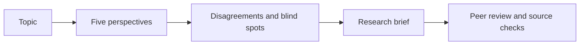

# STORM Research

**English** · [简体中文](README.zh-CN.md)

One question becomes more interesting when several perspectives get to ask the follow-ups.



An Agent Skill inspired by Stanford OVAL's STORM research approach. It packages a multi-perspective thinking framework into four prompts used sequentially in the same conversation.

## Four passes over a topic

| Pass | Output |
| --- | --- |
| Panorama | Practitioner, academic, skeptic, economist, and historian perspectives |
| Conflict map | Disagreements, evidence quality, shared conclusions, and blind spots |
| Research brief | Key findings, connections, role-specific actions, and open questions |
| Peer review | Confidence assessment, weakest claims, missing perspectives, and revisions |

The full prompts are in [references/prompts.md](references/prompts.md).

## Install and use

```bash
git clone https://github.com/Bill306/storm-research.git
cp -R storm-research ~/.codex/skills/storm-research
```

Use `~/.claude/skills/` or your configured shared directory for another compatible client.

```text
Use storm-research to explore how voice interfaces could help families
stay in touch with older relatives. My role is a product builder.
```

Replace `[YOUR TOPIC]` and `[YOUR ROLE]` in the prompts. Add `Answer in Chinese.` for Chinese output.

## Research boundary

This repository provides the questioning framework; it does not include STORM's retrieval system. A perspective generated from model knowledge needs independent source verification for factual claims, figures, and citations. Pair the prompts with search tools when sources are required.

The method references Stanford's STORM work. This prompt adaptation has no measured performance guarantee or fixed completion time. The [Skill](SKILL.md) defines its use for report preparation, learning, interviews, decisions, and research.

[MIT License](LICENSE).
